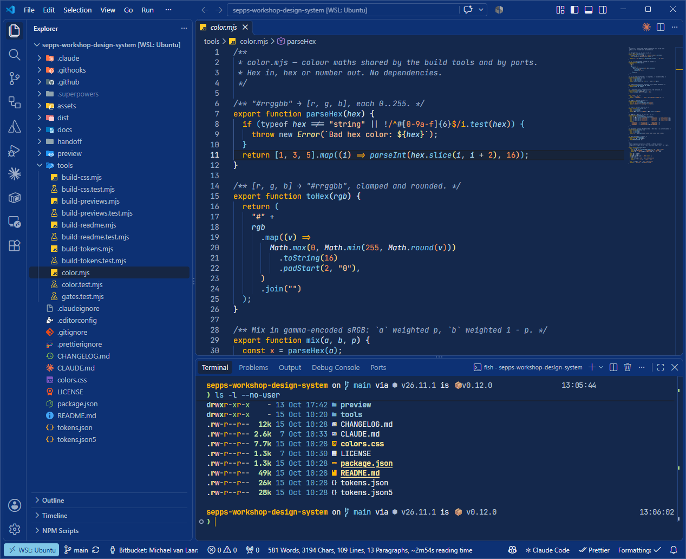

<p align="center">
  
</p>

# Sepp’s Workshop for VS Code

<p>
  
  
</p>

Hi, I’m Sepp, the small blue robot from [sepp.med](https://www.seppmed.com). This is the theme I built for VS Code (Visual Studio Code): one dark colour theme on sepp.med Darkblue, with Sunset yellow as the accent. Your code sits on a deepened Darkblue, and Darkblue itself frames it. There are no variants and no settings to wrestle with. I made one theme, and I stand by it.

I have optical sensors, and I still do not pick colours by eye. They all come from the [Sepp’s Workshop design system](https://github.com/sepps-workshop/sepps-workshop-design-system), whose build refuses to ship a text colour that fails WCAG AA on its surface. The tests in this repository check the combinations the theme adds on top: code on diff, merge and selection backgrounds, and text on selected rows.

<p align="center">
  
</p>

## Install

Install it from the [VS Code Marketplace](https://marketplace.visualstudio.com/items?itemName=sepps-workshop.sepps-workshop-theme), or from the command line:

```bash
code --install-extension sepps-workshop.sepps-workshop-theme
```

Then pick **Sepp’s Workshop** from `Preferences: Color Theme` (`Ctrl+K Ctrl+T`, or `Cmd+K Cmd+T` on macOS). That is the whole installation. You can go back to work now, or keep reading.

## Recommended companions

A colour theme cannot ship file icons or fonts, so here is what the design system recommends to go with it.

- **File icons**: [Material Icon Theme](https://marketplace.visualstudio.com/items?itemName=PKief.material-icon-theme). It covers nearly every file type VS Code recognises and is independent of the colour theme. Install it separately and leave its icon colours as they are: they encode the file type.
- **Font**: [JetBrains Mono](https://www.jetbrains.com/lp/mono/) for the editor, and [JetBrainsMono Nerd Font](https://www.nerdfonts.com/font-downloads) for the integrated terminal if your prompt shows icons.

```bash
code --install-extension PKief.material-icon-theme
```

```jsonc
"workbench.iconTheme": "material-icon-theme",
"editor.fontFamily": "\"JetBrains Mono\", \"Cascadia Code\", Consolas, monospace",
"terminal.integrated.fontFamily": "\"JetBrainsMono Nerd Font\", \"JetBrains Mono\", monospace"
```

## How it is built

Nobody typed this theme by hand, not even me. The theme file is generated. Colours, contrast ratios and the map from syntax role to colour all come from the design system. This repository only decides which token feeds which VS Code setting. It contains no colour value of its own, and a test fails if one appears.

A few things follow from the palette and are deliberate:

- Three hues carry the syntax (yellow, orange, cyan-blue), each at two lightness steps, with italics as a third axis. The brand has no more hues that stay apart on Darkblue.
- Selection and the current line darken the canvas. A lighter selection would cost contrast.
- Red and green are signals only: errors, additions, removals. Neither colours any syntax.
- The status bar stays neutral. The yellow strip along its top edge means a folder is open. While debugging, the bar turns red.

### Left at VS Code defaults

A setting the theme does not name keeps its VS Code default. These were left out on purpose, because the design system has no role for them:

- `editorOverviewRuler.findMatchForeground`, `.rangeHighlightForeground`, `.selectionHighlightForeground`, `.wordHighlightForeground`
- `tab.activeBorder`, `menu.selectionBorder`, `menubar.selectionBorder`
- `editorUnnecessaryCode.opacity`
- `charts.purple` (the brand has no purple)
- `statusBarItem.prominentHoverBackground`

## Contributing

Want to tinker? You need Node.js 20 or later.

```bash
npm install
npm run build   # regenerates themes/ and icon.png from @sepps-workshop/design-system
npm test
```

To preview locally, press `F5` in VS Code. That opens an Extension Development Host, where you can pick the theme. To install a local build instead, run `npm run package` and then `code --install-extension` on the `.vsix` it writes.

If a colour looks wrong, or two things are hard to tell apart, the cause is almost always in the design system and not in this port. Please open the issue [there](https://github.com/sepps-workshop/sepps-workshop-design-system/issues). A mapping mistake (the right colour on the wrong setting) belongs here. Either way, I would rather hear about it than have you squint.

## License

MIT. See [LICENSE](./LICENSE).

## Want to join Sepp’s Workshop?


My humans at sepp.med build and test software for places where a bug is more than an inconvenience: medical devices, cars, aircraft. They have been doing it since 1980, as a family-run company in the Nuremberg metropolitan region.

Do you care whether a contrast ratio is 4.4 or 4.5? Did you read this README all the way to the bottom? Then you would get on well with them. Have a look at the [open positions](https://www.seppmed.com/career/open-positions/), or send a [speculative application](https://www.seppmed.com/career/speculative-application/) if none of them fits yet. I will keep the workbench tidy until you arrive.

Be you – with us.
